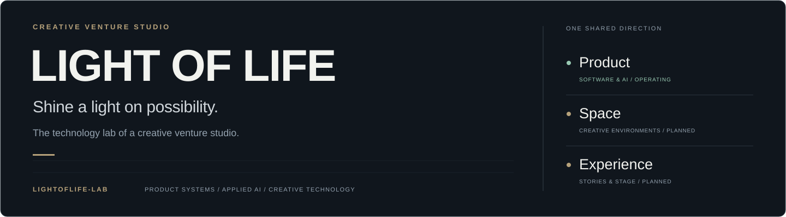
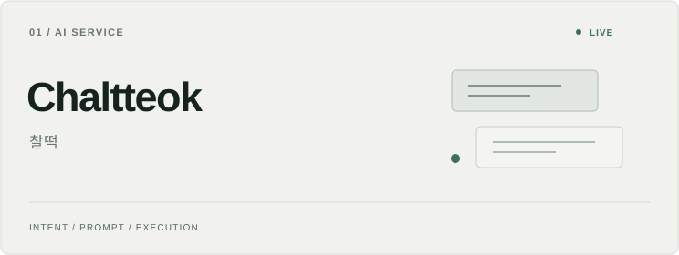
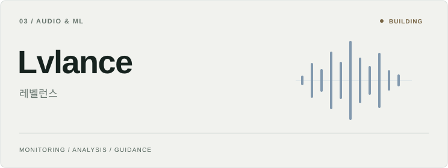
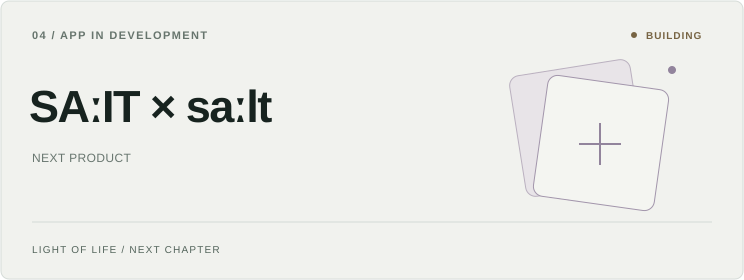
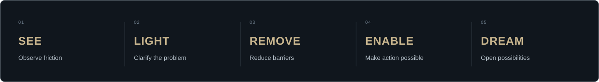

<strong>English</strong> · <a href="./README.ko.md">한국어</a>

**The technology lab of LIGHT OF LIFE.**

We turn real-world friction into products, tools, and room for new possibilities.

[Company](https://lightoflife.work/) · [Philosophy](https://lightoflife.work/philosophy) · [Products](https://lightoflife.work/projects) · [Contact](https://lightoflife.work/contact)

 

## 01 / Company & Purpose

**LIGHT OF LIFE is a creative venture studio.** We find the barriers that keep people from starting, creating, and moving forward, then reduce them through technology, spaces, and experiences.

| Identity | Our direction |
|:---|:---|
| **Mission** | Remove barriers. Reveal possibilities. |
| **Vision** | Create an environment where people can discover their possibilities and pursue bigger dreams. |

Three independent businesses share this purpose. Each has its own audience and business model.

<table>
<tr>
<td width="33%" valign="top">

#### Product

**Operating**

Apps, web services, and AI tools that make thinking and taking action easier.

[Product business →](https://lightoflife.work/business#product)

</td>
<td width="33%" valign="top">

#### Space

**Planned**

Creative spaces and production environments where people can focus on their work.

[Space business →](https://lightoflife.work/business#space)

</td>
<td width="33%" valign="top">

#### Experience

**Planned**

Documentaries, performances, exhibitions, and cultural experiences that open new perspectives.

[Experience business →](https://lightoflife.work/business#experience)

</td>
</tr>
</table>

**LIGHTOFLIFE-Lab puts the Product business into practice.** This is where we develop software, investigate applied AI, and build tools for automation, audio, search, and creative work—from prototypes to products we launch and operate.

## 02 / Product Portfolio

Our portfolio brings together live services and products in development.

<table>
<tr>
<td width="50%" valign="top">

### Chaltteok · 찰떡

**Live / AI service**

An everyday request becomes a usable prompt. Chaltteok asks about missing conditions, generates the prompt, and connects execution and feedback in one place.

[**Use Chaltteok ↗**](https://chaltteok.cc/)

</td>
<td width="50%" valign="top">

### Good Seeseon · 좋은 시선

**Live / News web app**

Understand the event, its context, and the reasons behind different perspectives. Explanations, questions, evidence, and original sources help readers form their own judgment.

[**Read Good Seeseon ↗**](https://goodseeseon.link/)

</td>
</tr>
<tr>
<td width="50%" valign="top">

### Lvlance · 레벨런스

**Building / Audio & ML**

Practical audio guidance for small worship and live teams. The LoLvlance browser implementation continuously analyzes microphone input and offers issue guidance and first-step EQ suggestions.

[**Explore LoLvlance ↗**](https://github.com/LIGHTOFLIFE-Lab/LoLvlance)

</td>
<td width="50%" valign="top">

### SAːIT × saːlt

**Building / Next product**

The next app product from LIGHT OF LIFE is in development. Further details are being prepared for public introduction.

[**Project updates ↗**](https://lightoflife.work/projects#salt)

</td>
</tr>
</table>

## 03 / Research & Engineering

The lab connects product questions with working implementations across four areas.

| Area | Applied focus |
|:---|:---|
| **Human–AI interaction** | Clarifying intent, generating usable instructions, and connecting AI responses to execution |
| **Evidence & information** | Context, source traceability, and reviewable research outputs |
| **Audio & creative technology** | Browser audio processing, ML integration, and guidance for live settings |
| **Workflow infrastructure** | MCP integrations, synchronization, deployment, and recoverable changes |

### Tools & Experiments

Selected public repositories. Prototypes and experiments are listed separately from the product portfolio above.

| Project | Engineering focus |
|:---|:---|
| **[DevLink-MCP](https://github.com/LIGHTOFLIFE-Lab/DevLink-MCP)** | Server configuration, MCP integration, file sync, deployment, and rollback |
| **[Markup TXT Studio](https://github.com/LIGHTOFLIFE-Lab/Markup-TXT-Studio)** | `ai.txt` / `llms.txt` generation and structured-data markup search |
| **[GEO-TESTER](https://github.com/LIGHTOFLIFE-Lab/GEO-TESTER)** · [GEO-DEMO](https://github.com/LIGHTOFLIFE-Lab/GEO-DEMO) | Website auditing and discovery experiments for AI search |
| **[SeeWe](https://github.com/Kimajun0919/SeeWe)** | A map-based MVP for Seoul crowd estimates and transport information |
| **[Yield Balance](https://github.com/Kimajun0919/Money-Balance)** | Personal asset-management and rebalancing prototypes |
| **[The Steps of Haneul](https://github.com/LIGHTOFLIFE-Lab/Bibleverses-Card-Template)** | Scripture recommendation and shareable verse-card images |

## 04 / Principles in Practice

We start with the person and the obstacle, define the problem, and build something they can actually use. Clear product scope, visible development status, and practical next steps guide how we communicate our work.

The name **LIGHT OF LIFE** is rooted in **Matthew 5:14–16**: light that helps people see a path and move forward. That belief shapes our company purpose across Product, Space, and Experience.

[Read our philosophy →](https://lightoflife.work/philosophy)

## 05 / Connect

For product ideas, joint development, and creative collaboration:

**[contact@lightoflife.work](mailto:contact@lightoflife.work)**

[Company website](https://lightoflife.work/) · [Business](https://lightoflife.work/business) · [Contact](https://lightoflife.work/contact) · [Founder](https://lightoflife.work/founder) · [LinkedIn](https://www.linkedin.com/company/lightoflife-work/)

 

**LIGHT OF LIFE**

Shine a light. Remove barriers. Make room for dreams.

